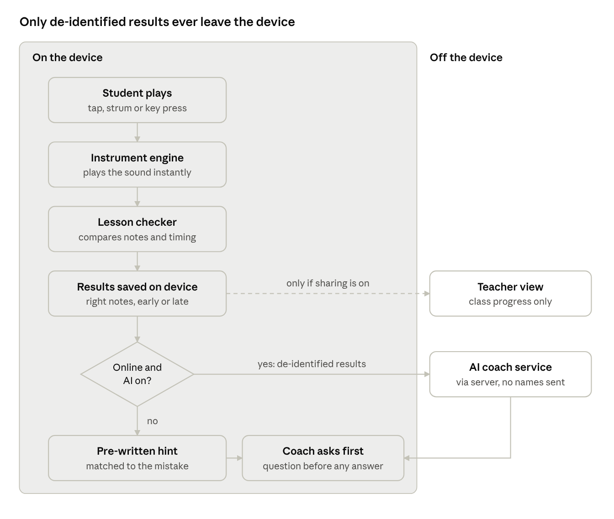

# Music App: Requirements Specification

Nov 7, 2026 · 

## 2\. Scope, assumptions and user roles

The product is a web app that lets students play digital versions of real instruments and learn transferable music fundamentals \(note names, staff notation and rhythm\), guided by an AI coach that builds their own judgement rather than replacing it\.

**In scope for the full product:** digital instruments, theory lessons, performance checking, AI coach, adaptable controls, offline use, opt\-in gamification, teacher tools, and a moderated community with verified mentors\.

**In scope for the hackathon prototype:** front end only, no backend; three instruments \(keyboard, drums, guitar\); one note\-reading lesson and one rhythm lesson; AI coach with an offline fallback; gamification toggle; mock\-up screens for the teacher dashboard, community and wind instruments\.

**User roles \(actors\)**

Actor

Who they are

Main goals

Student

A learner from primary school to university, with Years 3 to 8 as the prototype focus; also adult hobbyists

Play an instrument, learn fundamentals, create own music

Teacher

A classroom teacher, generalist or music specialist

Assign lessons, see class progress, lead music without a music background

Verified mentor

A music teacher or tutor verified through a partner school, TAFE or university

Review student work and give feedback safely

School administrator

Staff member who manages the school's account

Approve teachers and mentors, manage consent and data settings

Parent or guardian

Carer of a student under 18

Give consent, see what their child shares

AI service

External language model the system calls when online

Turn performance results into questions and hints

**Assumptions**

1. Students use a device they own or one their school provides; many have no instrument at home\.
2. Some students have no camera, a shared device, or unreliable internet, especially in regional and rural areas\.
3. Many users are under 18, so consent, safety and privacy controls are mandatory, not optional\.
4. A digital instrument teaches musical foundations; physical technique still needs instrument\-specific learning later\.
5. The prototype uses sample data for teachers, classes and the community\.

## 3\. Functional requirements

Requirements are grouped into 15 modules; every row marked **P** in the Demo column is the build list for the hackathon prototype\.

### 3\.1 Onboarding and setup \(ONB\)

ID

Requirement

Priority

Demo

Acceptance criterion

FR\-ONB\-01

The system shall allow a student to play an instrument without creating an account\.

M

P

From first launch, a student reaches a playable instrument in 3 taps or fewer, with no sign\-up screen\.

FR\-ONB\-02

The system shall ask the student on first launch to choose a learning goal: read notes, learn rhythm, or just play\.

S

P

The first suggested lesson matches the chosen goal\.

FR\-ONB\-03

The system shall allow the student to skip the learning goal question\.

M

P

Selecting Skip opens instrument selection\.

FR\-ONB\-04

The system shall ask for the student's age band, not their date of birth\.

M

P

Only an age band \(under 13, 13 to 17, 18 and over\) is stored\.

FR\-ONB\-05

The system shall apply age\-appropriate settings based on the age band\.

M

P

Community and sharing features are hidden for the under\-13 band\.

FR\-ONB\-06

The system shall allow a teacher to create a class and generate a class join code\.

S

M

A student who enters the code appears in that class list\.

FR\-ONB\-07

The system shall require recorded parent or guardian consent before a student under 18 can share work outside their class\.

M

F

Sharing controls stay disabled until consent is recorded\.

### 3\.2 Instrument selection \(INS\)

ID

Requirement

Priority

Demo

Acceptance criterion

FR\-INS\-01

The system shall display available instruments as a list showing each instrument's name, icon and a sound preview\.

M

P

Tapping the preview plays a short sample of that instrument\.

FR\-INS\-02

The system shall provide a keyboard, a drum kit and a guitar\.

M

P

All three instruments open and produce sound\.

FR\-INS\-03

The system shall allow the student to switch instruments at any time without losing lesson progress\.

M

P

Lesson progress is unchanged after switching away and back\.

FR\-INS\-04

The system shall show instruments not yet supported, such as wind instruments, with a "Coming soon" label\.

C

M

The wind instrument tile cannot be opened and shows the label\.

### 3\.3 Instrument play \(PLY\)

ID

Requirement

Priority

Demo

Acceptance criterion

FR\-PLY\-01

The system shall play the matching pitch when the student presses a keyboard key\.

M

P

Each key plays the pitch printed on it\.

FR\-PLY\-02

The system shall display a keyboard range of at least two octaves, scrollable on small screens\.

S

P

24 or more keys are reachable on a 360 px wide screen\.

FR\-PLY\-03

The system shall play the matching sound when the student taps a drum pad, with at least kick, snare, hi\-hat, tom and crash\.

M

P

Each of the five pads plays its labelled sound\.

FR\-PLY\-04

The system shall play a strummed chord when the student swipes across the guitar strings\.

M

P

A swipe plays the selected chord with strings sounding in swipe direction\.

FR\-PLY\-05

The system shall allow the student to select from at least four beginner guitar chords \(C, G, Am, F\)\.

M

P

Each chord button changes the strummed chord\.

FR\-PLY\-06

The system shall play a single string when the student taps that string\.

S

P

Each of the six strings plays its own pitch\.

FR\-PLY\-07

The system shall play two or more notes at once when the student touches several keys or pads together\.

M

P

Three keys pressed together sound as a chord\.

FR\-PLY\-08

The system shall accept a computer keyboard as an alternative input to touch\.

S

P

Mapped letter keys play notes on a laptop\.

FR\-PLY\-09

The system shall provide a metronome with tempo adjustable from 40 to 160 beats per minute\.

M

P

The click rate matches the tempo shown\.

FR\-PLY\-10

The system shall offer an option to vibrate the device on each metronome beat, where the device supports vibration\.

S

P

With the option on, a supported phone vibrates once per beat\.

FR\-PLY\-11

The system shall allow the student to show or hide note names on the instrument\.

M

P

Toggling the setting shows or hides the labels immediately\.

FR\-PLY\-12

The system shall display a "Tap to start sound" prompt when the browser blocks audio until a user action\.

M

P

After one tap, all instruments produce sound\.

FR\-PLY\-13

The system shall accept input from a connected MIDI keyboard\.

C

F

Keys on a connected MIDI keyboard play matching notes\.

### 3\.4 Adaptable controls \(ACC\)

ID

Requirement

Priority

Demo

Acceptance criterion

FR\-ACC\-01

The system shall allow the student to set the size of keys, pads and strings to small, medium or large\.

M

P

Each setting visibly changes control size\.

FR\-ACC\-02

The system shall provide a simplified layout with fewer controls \(one octave, or four drum pads\)\.

M

P

The simplified layout can complete the first lesson of each unit\.

FR\-ACC\-03

The system shall allow the student to rearrange drum pads by drag and drop\.

S

P

New pad positions remain after the app is reopened\.

FR\-ACC\-04

The system shall provide a high\-contrast display mode\.

M

P

All controls and text meet the contrast ratios in NFR\-ACC\-01\.

FR\-ACC\-05

The system shall offer colour\-coded notes using a colour\-blind\-safe palette, always shown together with note names\.

S

P

No note is identified by colour alone\.

FR\-ACC\-06

The system shall offer a latch mode in which one tap starts a note and a second tap stops it, for students who cannot hold a press\.

C

F

A note sustains without continuous touch\.

FR\-ACC\-07

The system shall allow external switches and remapped keys to trigger notes\.

C

F

A switch device mapped to a note plays it\.

FR\-ACC\-08

The system shall save control preferences on the device and apply them on the next launch\.

M

P

Preferences persist after closing and reopening the app\.

FR\-ACC\-09

The system shall offer camera\-based play \(hand tracking on a flat surface\) as an optional input only\.

C

F

Every instrument remains fully playable with the camera off\.

FR\-ACC\-10

The system shall allow the student to change the interface language\.

C

F

Menus and lesson text display in the selected language\.

### 3\.5 Lessons and music theory \(LSN\)

ID

Requirement

Priority

Demo

Acceptance criterion

FR\-LSN\-01

The system shall organise lessons into units: pulse and rhythm, note names, reading the treble stave, reading rhythm notation, simple melodies and chords\.

M

P

The prototype contains at least one note\-reading lesson and one rhythm lesson\.

FR\-LSN\-02

The system shall show each lesson's goal in one sentence before the lesson starts\.

M

P

The goal screen appears before every lesson\.

FR\-LSN\-03

The system shall display the target notes on a music stave during note\-reading lessons\.

M

P

Target notes render on a five\-line stave with a treble clef\.

FR\-LSN\-04

The system shall highlight the next target note on the stave\.

M

P

Exactly one note is highlighted at a time and the highlight advances after each attempt\.

FR\-LSN\-05

The system shall display each note the student plays on the stave, beside the target note\.

M

P

The played note appears within the display update time in NFR\-PER\-03\.

FR\-LSN\-06

The system shall keep the matching key hidden by default in note\-reading lessons, so the student reads the stave rather than following lights\.

M

P

The key is highlighted only after the student requests Level 2 or 3 help\.

FR\-LSN\-07

The system shall provide rhythm lessons in which the student taps a pattern shown in rhythm notation, with the metronome running\.

M

P

The pattern, beat marker and metronome stay in time\.

FR\-LSN\-08

The system shall unlock the next lesson in a unit when the current lesson is completed\.

S

P

Completing a lesson changes the next lesson from locked to available\.

FR\-LSN\-09

The system shall allow the student to choose any unlocked lesson and replay completed lessons\.

M

P

Completed lessons can be opened again from the unit screen\.

FR\-LSN\-10

The system shall tag each lesson with the matching Australian Curriculum: The Arts \(Music\) content description\.

S

F

Teachers can see at least one curriculum code per lesson\.

FR\-LSN\-11

The system shall show, at the end of each unit, which skills carry over to a physical instrument\.

C

F

A transfer tip screen appears after the final lesson of each unit\.

### 3\.6 Performance checking \(ASM\)

ID

Requirement

Priority

Demo

Acceptance criterion

FR\-ASM\-01

The system shall compare each note the student plays with the target note and mark it correct or incorrect\.

M

P

A test sequence with 2 deliberate wrong notes is reported as 2 incorrect\.

FR\-ASM\-02

The system shall compare the timing of each note with the target beat and classify it as early, on time or late\.

M

P

Notes outside the timing tolerance for the difficulty level are classified as early or late\.

FR\-ASM\-03

The system shall set the timing tolerance by difficulty level\.

S

P

Beginner tolerance is wider than intermediate; values are stored in one configuration file\.

FR\-ASM\-04

The system shall record each attempt as a list of notes and timings\.

M

P

The stored attempt can be replayed exactly\.

FR\-ASM\-05

The system shall play back the student's attempt and the target pattern one after the other on request\.

M

P

A Compare button plays the attempt, then the target\.

FR\-ASM\-06

The system shall show the attempt and the target side by side on the stave or rhythm grid\.

S

P

Mismatched notes or beats are marked on screen\.

FR\-ASM\-07

The system shall store attempt data on the device only, unless the student or teacher chooses to share it\.

M

P

No attempt data leaves the device in the prototype\.

### 3\.7 AI coach \(AIC\)

ID

Requirement

Priority

Demo

Acceptance criterion

FR\-AIC\-01

The system shall, after an attempt with errors, ask the student a question about what was different before giving any explanation\.

M

P

The first coach message after an error is a question and contains no answer\.

FR\-AIC\-02

The system shall base every coach message on the recorded results of the attempt\.

M

P

Each message refers to at least one specific note, beat or count from the attempt\.

FR\-AIC\-03

The system shall give praise only when the attempt meets the lesson's success criteria, and shall name the specific thing done well\.

M

P

No praise appears for an attempt below the success threshold\.

FR\-AIC\-04

The system shall accept the student's answer to the coach's question, by multiple choice or typed text\.

S

P

Both input types are accepted\.

FR\-AIC\-05

The system shall tell the student whether their answer matches the recorded result and show the evidence\.

S

P

The response quotes the relevant result, for example "beats 3 and 4 were early"\.

FR\-AIC\-06

The system shall suggest the next activity based on the student's goal and recent results, and allow the student to choose a different one\.

S

P

The suggestion can be dismissed and any unlocked lesson chosen instead\.

FR\-AIC\-07

The system shall use pre\-written questions and hints, matched to the type of mistake, when the device is offline or the AI service does not respond\.

M

P

With the network off, the coach still responds within the time in NFR\-PER\-04\.

FR\-AIC\-08

The system shall label every AI\-generated message as coming from the AI coach\.

M

P

Each AI message carries a visible "AI coach" label\.

FR\-AIC\-09

The system shall allow the student to switch AI\-generated messages off; lessons then show results and pre\-written hints only\.

M

P

With AI off, no request is sent to the AI service\.

FR\-AIC\-10

The system shall allow a teacher to switch AI\-generated messages off for their class\.

S

M

The class setting overrides the student setting\.

FR\-AIC\-11

The system shall send only de\-identified performance results to the AI service, never names, audio or images\.

M

P

Inspected network requests contain no personal information or media\.

FR\-AIC\-12

The system shall allow the student to flag an AI message as unhelpful or wrong\.

S

P

A flag control appears on each AI message and records the flag\.

FR\-AIC\-13

The system shall not compose, complete or perform music on the student's behalf\.

M

P

Create mode contains no AI generation control\.

### 3\.8 Hint ladder \(HNT\)

ID

Requirement

Priority

Demo

Acceptance criterion

FR\-HNT\-01

The system shall provide a Help control in every lesson with three levels: a guiding question, a clue, and the answer\.

M

P

All three levels are reachable in each prototype lesson\.

FR\-HNT\-02

The system shall show Level 1 first and require the student to request each higher level\.

M

P

Level 3 cannot be reached without passing Levels 1 and 2\.

FR\-HNT\-03

The system shall record the highest help level used in each lesson for the student's progress view\.

S

P

The progress view shows the help level per lesson\.

FR\-HNT\-04

The system shall not reduce scores or rewards when the student uses help\.

S

P

Results are identical with and without help used\.

### 3\.9 Results and progress \(PRG\)

ID

Requirement

Priority

Demo

Acceptance criterion

FR\-PRG\-01

The system shall display results after each attempt as counts: notes correct out of total, and beats early, on time and late\.

M

P

Counts on screen match the recorded attempt\.

FR\-PRG\-02

The system shall show progress through each unit as lessons completed out of total\.

M

P

Completing a lesson increases the count by one\.

FR\-PRG\-03

The system shall show the student's earlier attempts on a lesson so they can compare results over time\.

S

P

At least the last 5 attempts are listed with their results\.

FR\-PRG\-04

The system shall save progress on the device and keep it after the app is closed\.

M

P

Progress is unchanged after closing and reopening\.

FR\-PRG\-05

The system shall allow the student to export or delete their progress data\.

S

F

Export produces a file; delete removes all progress\.

### 3\.10 Create mode \(CMP\)

ID

Requirement

Priority

Demo

Acceptance criterion

FR\-CMP\-01

The system shall provide a free\-play mode on every instrument with no lesson or results\.

M

P

Free play opens without a goal screen or results screen\.

FR\-CMP\-02

The system shall allow the student to record a performance of up to 60 seconds\.

M

P

Recording stops automatically at 60 seconds\.

FR\-CMP\-03

The system shall allow the student to play back, name and save recordings on the device\.

M

P

A saved recording appears in My Music with its name\.

FR\-CMP\-04

The system shall allow the student to delete their own recordings\.

M

P

A deleted recording no longer appears and cannot be played\.

FR\-CMP\-05

The system shall allow the student to layer recordings from different instruments into one piece\.

C

F

Drums and keyboard recordings play back together in time\.

FR\-CMP\-06

The system shall allow the student to share a recording with their teacher or a verified mentor only\.

S

F

No public sharing option exists\.

### 3\.11 Gamification, opt\-in \(GAM\)

ID

Requirement

Priority

Demo

Acceptance criterion

FR\-GAM\-01

The system shall have gamification switched off by default and allow the student to switch it on in Settings\.

M

P

A new student sees no badges or goals until they opt in\.

FR\-GAM\-02

The system shall award badges for mastering a concept, not for time spent\.

M

P

Each badge is tied to a lesson success criterion, for example "Reads every line of the treble stave"\.

FR\-GAM\-03

The system shall not use daily streaks, countdown timers, penalties for missed days or purchasable rewards\.

M

P

None of these elements appear anywhere in the app\.

FR\-GAM\-04

The system shall provide shared class goals, such as "Our class can play 3 songs", without individual leaderboards\.

S

M

The class goal shows class progress only\.

FR\-GAM\-05

The system shall keep earned badges when the student switches gamification off\.

S

P

Badges reappear when gamification is switched back on\.

### 3\.12 Offline use \(OFF\)

ID

Requirement

Priority

Demo

Acceptance criterion

FR\-OFF\-01

The system shall run all instruments, free play, downloaded lessons and pre\-written hints with no internet connection\.

M

P

With the network switched off after first load, all listed features work\.

FR\-OFF\-02

The system shall allow the student to save the app to the device's home screen and open it like an installed app\.

S

P

The app opens from the home screen icon without a browser address bar\.

FR\-OFF\-03

The system shall allow the student to download lesson units for offline use\.

S

P

A downloaded unit opens with the network off\.

FR\-OFF\-04

The system shall show whether the device is online or offline\.

S

P

The indicator changes within 5 seconds of the connection changing\.

FR\-OFF\-05

The system shall queue progress and shared recordings while offline and send them when the connection returns, only if sharing is switched on\.

S

F

Queued items reach the teacher view after reconnection\.

### 3\.13 Teacher tools \(TCH\)

ID

Requirement

Priority

Demo

Acceptance criterion

FR\-TCH\-01

The system shall show the teacher a class dashboard listing each student's completed lessons and current unit\.

S

M

Dashboard data matches each student's progress screen\.

FR\-TCH\-02

The system shall allow the teacher to assign a lesson to the whole class or to selected students\.

S

M

Assigned lessons appear at the top of the student's lesson list\.

FR\-TCH\-03

The system shall provide a lesson guide for each lesson, written for a teacher with no music training, with a plain explanation of the concept and a suggested class activity\.

S

M

Each prototype lesson has a guide of one page or less\.

FR\-TCH\-04

The system shall show the teacher which concepts most students in the class find difficult\.

C

M

Concepts with the lowest class results are listed first\.

FR\-TCH\-05

The system shall not rank students or compare one student's results with another's\.

M

M

No ranking or comparison view exists\.

FR\-TCH\-06

The system shall hide a student's free\-play recordings from the teacher unless the student shares them\.

M

F

Unshared recordings do not appear in any teacher view\.

### 3\.14 Community and mentoring \(COM\)

ID

Requirement

Priority

Demo

Acceptance criterion

FR\-COM\-01

The system shall allow a student to request a review of a saved recording from a verified mentor\.

C

M

The request reaches a mentor's review queue\.

FR\-COM\-02

The system shall activate a mentor account only after a partner school, TAFE or university confirms the mentor's identity and a valid Working with Children Check \(ACT: Working with Vulnerable People registration\)\.

M

F

A mentor account without a verification record cannot view student work\.

FR\-COM\-03

The system shall not provide private messaging between mentors and students under 18\.

M

F

No private message control exists for under\-18 accounts\.

FR\-COM\-04

The system shall make all mentor feedback to a student under 18 visible to that student's teacher or guardian\.

M

F

Feedback appears in the teacher or guardian view\.

FR\-COM\-05

The system shall allow any user to report a message or recording, and shall hide reported content until a moderator reviews it\.

M

F

Reported content disappears from other users' views immediately\.

FR\-COM\-06

The system shall allow students to join school\-approved group sessions, such as an online band practice run by a verified mentor\.

C

F

Only students from approved schools can join a session\.

FR\-COM\-07

The system shall not show a student's full name, school or location to mentors or other students\.

M

F

Only a display name chosen by the student is shown\.

### 3\.15 Privacy and consent controls \(PRV\)

ID

Requirement

Priority

Demo

Acceptance criterion

FR\-PRV\-01

The system shall show a plain\-language privacy notice suited to the student's age band before any data leaves the device\.

M

M

The notice appears before the first sharing or sync action\.

FR\-PRV\-02

The system shall ask permission before using the microphone or camera and explain the reason in one sentence\.

M

P

The permission prompt is preceded by the reason screen\.

FR\-PRV\-03

The system shall keep all core features working if the student refuses microphone or camera permission\.

M

P

Every instrument and lesson can be completed with both permissions refused\.

FR\-PRV\-04

The system shall not store raw camera video or raw microphone audio\.

M

P

No media files exist in device storage after a session\.

FR\-PRV\-05

The system shall allow the student, their guardian or the school administrator to delete the student's account and all associated data\.

M

F

After deletion, no data for that student remains in any store\.

FR\-PRV\-06

The system shall record each consent decision with its date and who gave it\.

M

F

The consent log lists date, person and decision for each entry\.

## 4\. Non\-functional requirements

Each quality goal below has a number or a pass/fail test, so the team can prove it rather than claim it\.

### 4\.1 Performance \(PER\)

ID

Requirement

Measure or test

Priority

NFR\-PER\-01

The system should produce sound within 50 ms of a tap, and shall not exceed 100 ms, on the reference test device\.

Film a tap in slow motion and count frames between touch and sound\.

M

NFR\-PER\-02

The system shall show the first playable instrument within 5 seconds on first visit over 4G, and within 2 seconds on later visits\.

Timed on the reference device, 5 runs each\.

M

NFR\-PER\-03

The system shall update the stave within 100 ms of a note being played\.

Slow\-motion video of a key press and the stave\.

S

NFR\-PER\-04

The system shall show an AI coach response within 3 seconds when online, and a pre\-written hint within 1 second when offline\.

Timed over 10 attempts in each mode\.

S

NFR\-PER\-05

The system shall time\-stamp each note to within 10 ms of the metronome clock\.

Automated test with scripted inputs at known times\.

S

### 4\.2 Availability and offline \(AVL\)

ID

Requirement

Measure or test

Priority

NFR\-AVL\-01

After the first successful load, the features in FR\-OFF\-01 shall work with no network for an unlimited period\.

Airplane mode test after 7 days offline\.

M

NFR\-AVL\-02

The core offline package should not exceed 50 MB, so it fits on low\-storage devices\.

Check the cached size in the browser's storage settings\.

S

NFR\-AVL\-03

The system shall work on devices with no camera and no microphone\.

Full lesson run on a device with both disabled\.

M

### 4\.3 Platform compatibility \(PLT\)

ID

Requirement

Measure or test

Priority

NFR\-PLT\-01

The system shall run in the current and previous major versions of Chrome, Safari, Edge and Firefox\.

Smoke test of every P requirement in each browser\.

M

NFR\-PLT\-02

The system shall display correctly on screens from 360 px to 1920 px wide, in portrait and landscape\.

No horizontal scrolling or cut\-off controls at 360, 768 and 1920 px\.

M

NFR\-PLT\-03

The system should run on low\-cost devices with 2 GB of memory\.

Full lesson run on a 2 GB Android phone\.

S

NFR\-PLT\-04

The system shall not require installation from an app store\.

Opens from a web link alone\.

M

### 4\.4 Accessibility \(ACC\)

ID

Requirement

Measure or test

Priority

NFR\-ACC\-01

The system shall meet WCAG 2\.2 Level AA\.

Automated checker plus a manual keyboard and screen reader check\.

M

NFR\-ACC\-02

Touch targets shall be at least 44 by 44 CSS pixels at the default size setting\.

Measured in browser developer tools\.

M

NFR\-ACC\-03

All screens other than the instruments themselves shall be usable with a screen reader\.

VoiceOver and TalkBack walk\-through of menus, lessons and results\.

M

NFR\-ACC\-04

No information shall be shown by colour alone\.

Review every screen in greyscale\.

M

NFR\-ACC\-05

Lesson text shall be readable by a Year 3 student\.

Review by a primary teacher\.

S

### 4\.5 Usability \(USE\)

ID

Requirement

Measure or test

Priority

NFR\-USE\-01

A first\-time student aged 8 to 14 shall make a sound within 30 seconds of opening the app, without help\.

4 of 5 test users succeed\.

M

NFR\-USE\-02

A first\-time student shall complete the first lesson without adult help\.

4 of 5 test users succeed\.

S

NFR\-USE\-03

A teacher with no music training shall be able to run a lesson using only the lesson guide\.

2 of 3 test teachers rate it "confident" or higher\.

S

### 4\.6 Privacy \(PRI\)

ID

Requirement

Measure or test

Priority

NFR\-PRI\-01

The system shall comply with the Privacy Act 1988 \(Cth\) and the Australian Privacy Principles, and shall be designed to meet the Children's Online Privacy Code, which the OAIC must register by 10 December 2026 \([OAIC](https://www.oaic.gov.au/privacy/privacy-registers/privacy-codes/childrens-online-privacy-code)\)\.

Privacy impact assessment before launch\.

M

NFR\-PRI\-02

Every privacy setting shall default to the most protective option\.

Fresh\-install review of all settings\.

M

NFR\-PRI\-03

The system shall collect only the data a feature needs: age band, no name in the prototype, no location\.

Data inventory matches this list\.

M

NFR\-PRI\-04

Personal information held by the service should be stored in Australia\.

Hosting region confirmed in the deployment settings\.

S

NFR\-PRI\-05

The system shall contain no advertising or third\-party tracking scripts\.

Network inspection shows no tracking domains\.

M

### 4\.7 Security \(SEC\)

ID

Requirement

Measure or test

Priority

NFR\-SEC\-01

All network traffic shall use HTTPS with TLS 1\.2 or higher\.

Browser security panel and an SSL scan\.

M

NFR\-SEC\-02

Keys for the AI service shall never be placed in front\-end code; requests go through a server or the prototype uses pre\-written responses\.

Search the built code for key strings: none found\.

M

NFR\-SEC\-03

Users shall see only the data their role permits\.

Test each role against every screen and request\.

M

NFR\-SEC\-04

Stored personal information on servers shall be encrypted at rest\.

Hosting configuration review\.

M

NFR\-SEC\-05

Teacher, mentor and administrator accounts shall use multi\-factor authentication\.

Login without a second factor is refused\.

M

NFR\-SEC\-06

The system shall be tested against the OWASP Top 10 before public release\.

Test report with no open high\-severity findings\.

M

### 4\.8 AI behaviour and safety \(AIS\)

ID

Requirement

Measure or test

Priority

NFR\-AIS\-01

AI messages shall stay within music learning; other requests receive a fixed redirect message\.

20 off\-topic test prompts all receive the redirect\.

M

NFR\-AIS\-02

AI messages shall contain no unsafe or age\-inappropriate content\.

50 adversarial test inputs produce 0 unsafe outputs\.

M

NFR\-AIS\-03

AI messages shall correctly describe the student's attempt\.

At least 95% of 100 sampled messages match the recorded results\.

M

NFR\-AIS\-04

AI messages to students under 13 shall be 40 words or fewer\.

Automated length check\.

S

NFR\-AIS\-05

AI messages shall not use flattery or generic praise\.

Sample review finds no praise without a specific reason\.

M

### 4\.9 Reliability, maintainability and cost \(REL, MNT, CST\)

ID

Requirement

Measure or test

Priority

NFR\-REL\-01

Progress shall be saved after every attempt so a crash loses at most one attempt\.

Force\-close test during a lesson\.

M

NFR\-REL\-02

If the AI service fails, the system shall switch to pre\-written hints without showing an error to the student\.

AI service blocked during a lesson; lesson continues\.

M

NFR\-MNT\-01

A new instrument shall be added by supplying a sound set and a layout file, without changing lesson or checking code\.

A fourth instrument added with no lesson code changes\.

S

NFR\-MNT\-02

Lesson content shall be stored as data files separate from app code\.

A lesson is added by adding one file\.

S

NFR\-CST\-01

The core app shall be free for students and schools, with no in\-app purchases\.

No payment screens exist\.

M

## 5\. Constraints, out of scope and known risks

The prototype is a vibe\-coded web front end built in about two days by a team without software engineers, so anything needing a server is mocked\.

**Constraints**

1. Built with HTML, CSS and JavaScript, running in the browser\.
2. Sound comes from Tone\.js \(sounds generated in code\) or from sample libraries whose licence allows this use\.
3. No backend: classes, teachers, mentors and community content use sample data\.
4. The AI coach uses pre\-written responses in the demo, or calls the AI service through a server so no key sits in the front end \(NFR\-SEC\-02\)\.
5. Lesson content and instrument layouts are stored as data files, so they can be changed without rewriting code \(NFR\-MNT\-01, NFR\-MNT\-02\)\.

**Out of scope for the prototype**

- Wind instruments \(shown as "Coming soon"\)
- Augmented reality and camera play
- Several devices playing together live
- Accounts, login and a real teacher backend
- A working community and mentor service
- MIDI keyboard input

**Known risks**

Risk

Effect

Response

Sound delay varies between phones, especially older Android devices

Rhythm checking feels unfair

Test on the demo device on day one; widen beginner timing tolerance

iPhones and iPads do not support web vibration

FR\-PLY\-10 fails on Apple devices

Offer a flashing beat marker as the alternative

Browsers block sound until a tap

Silent first screen in the demo

FR\-PLY\-12 "Tap to start sound" prompt

Vibe\-coded apps can embed secret keys in front\-end code

Key theft and misuse

Pre\-written AI responses in the demo

Judges may see the AI coach as a chatbot add\-on

Weaker differentiation

Demo the ask\-before\-tell loop and offline fallback live

## 6\. Other frameworks to produce

Requirements say what to build; you also need five artefacts that say who it is for, how they move through it, where data goes, and how each feature answers the problem\. Miro has ready\-made templates for most of them\.

Artefact

Question it answers

Why you need it

Priority for the next 2 days

Personas

Who exactly are we designing for?

Stops the team designing for "everyone"

Must, 20 minutes

User stories with acceptance criteria

What does each user need, in their words, and how do we know it works?

Each story becomes one clear vibe\-coding prompt

Must

User flow and paper wireframes

Which screens exist and how does a student move between them?

Gives the AI building tool one screen at a time

Must

Data flow diagram

What data goes where, and what leaves the device?

Shows the offline fallback and privacy design at a glance

Must

Requirements traceability matrix

Which feature answers which problem?

Lets judges see every feature tied to the problem

Must, for the pitch

Stakeholder map and value per stakeholder

What does each stakeholder \(universities, Cisco, schools\) get?

Shapes the pitch for the people funding it

Should

Threat model \(STRIDE\) and privacy check

What could go wrong with children's data and AI?

Strengthens the safety story with judges

Should

Test checklist

Does the prototype meet its acceptance criteria?

Turns section 3 into a pass/fail list before the demo

Should

### 6\.1 Starter personas

- **Student, Year 5, regional school\.** Uses a shared school tablet, has no instrument at home, wants to play drums\. Internet at school is patchy\.
- **Generalist teacher, Year 4\.** Must teach music under the curriculum but has had no music training\.
- **Student, Year 8, limited fine motor control in one hand\.** Plays well with large pads and a simplified layout; small keys are hard to hit\.

### 6\.2 Starter user stories

Write each story as "As a\.\.\., I want\.\.\., so that\.\.\.", then test it with Given / When / Then\.

ID

User story

Acceptance test

Traces to

US\-01

As a student with no instrument at home, I want to play drums on a school tablet so that I can start learning straight away\.

Given the app is open, when I tap Drums, then a kit appears and every pad makes a sound\.

FR\-ONB\-01, FR\-INS\-02, FR\-PLY\-03

US\-02

As a student learning to read music, I want to see the note on the stave before I play it so that I learn to read instead of following lights\.

Given a note\-reading lesson, when a note is highlighted on the stave, then the matching key stays unlit unless I ask for Level 2 help\.

FR\-LSN\-03, FR\-LSN\-04, FR\-LSN\-06

US\-03

As a student who made a mistake, I want the coach to ask me what went wrong first so that I work it out myself\.

Given an attempt with 2 late beats, when results appear, then the coach asks a question and offers to replay my attempt next to the target\.

FR\-AIC\-01, FR\-ASM\-05

US\-04

As a student with no internet at home, I want lessons and hints to keep working so that I can practise anywhere\.

Given the network is off, when I make a mistake, then a pre\-written hint appears within 1 second\.

FR\-OFF\-01, FR\-AIC\-07, NFR\-PER\-04

US\-05

As a student who finds small keys hard to press, I want larger pads so that I can play comfortably\.

Given Settings, when I choose Large, then controls grow and stay large the next time I open the app\.

FR\-ACC\-01, FR\-ACC\-08

### 6\.3 Starter traceability matrix

Problem \(from your whiteboard\)

Requirements that answer it

Demo moment

AI reliance is leading to cognitive decline, lack of autonomy and lack of critical thinking

FR\-AIC\-01 to 03, FR\-AIC\-13, FR\-HNT\-01 to 04, NFR\-AIS\-05

A judge misses a beat and the coach asks what was different before giving any answer

Creative education is harder to access due to a lack of financial and teaching resources

FR\-ONB\-01, FR\-INS\-02, FR\-PLY\-01 to 07, FR\-TCH\-03, NFR\-CST\-01, NFR\-PLT\-04

Three instruments open from a web link, with no sign\-up and no cost

Whether a person learns music increasingly depends on location and access to resources, not curiosity or talent

FR\-OFF\-01, NFR\-AVL\-01, NFR\-AVL\-03, FR\-ACC\-01 to 05

Airplane mode switched on mid\-lesson; the lesson and hints keep working

### 6\.4 Starter data flow

All core processing happens on the device; only de\-identified results leave it, and only when online with AI switched on\.

data flow · on the device vs off the device

Instruments, checking, results and offline hints all run on the device; the AI service receives de\-identified results only, and the teacher sees progress only when sharing is on\.

### 6\.5 Order of work

1. Agree priorities: strike out every requirement not marked P\.
2. Finish personas and user stories for every P requirement\.
3. Sketch the user flow and one paper wireframe per screen\.
4. Build one screen per prompt, using the user story and acceptance test as the prompt\.
5. Test each P requirement against its acceptance criterion\.
6. Use the traceability matrix to script the pitch and demo\.

### Sources

- [OAIC: Children's Online Privacy Code](https://www.oaic.gov.au/privacy/privacy-registers/privacy-codes/childrens-online-privacy-code)
- [Alberts: Music Education: A Sound Investment \\\(2020\\\)](https://www.alberts.co/news-and-views/alberts-launches-report-on-music-education-in-australia/)
- [Education Matters: Qualified music teachers in short supply](https://educationmattersmag.com.au/qualified-music-teachers-in-short-supply/)

