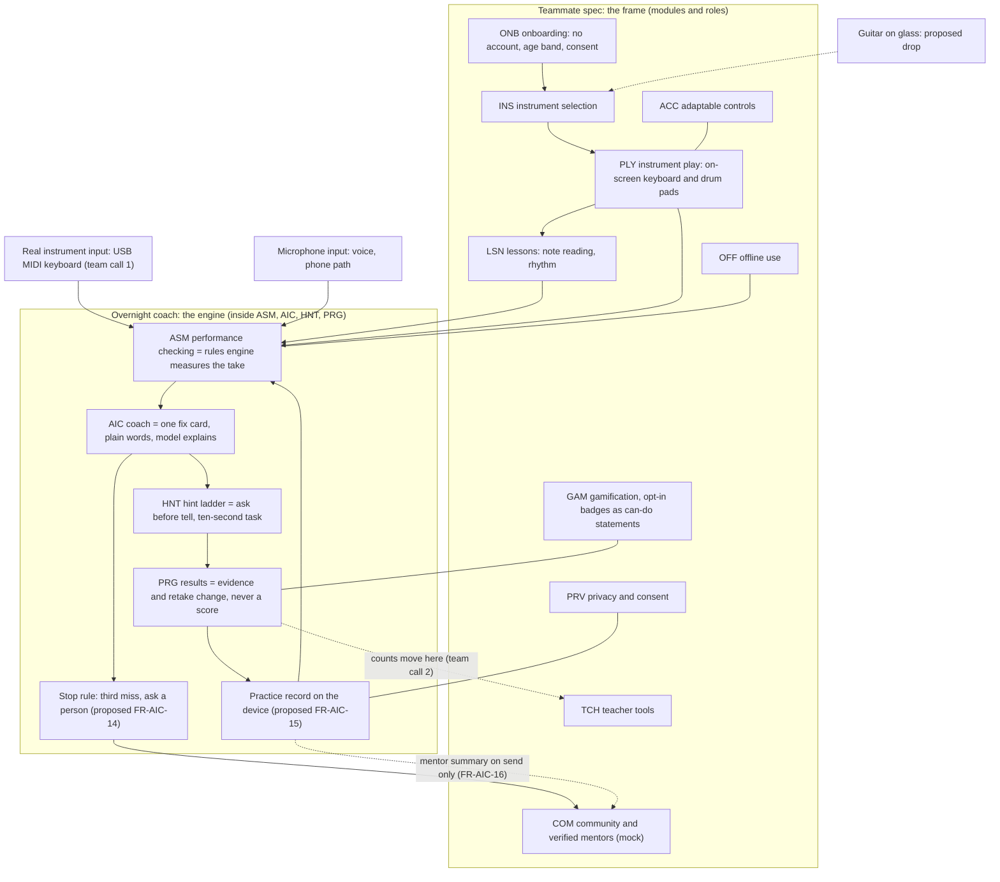
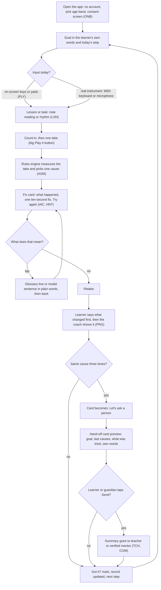
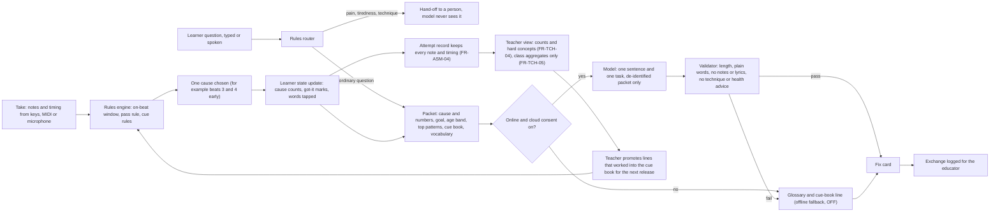
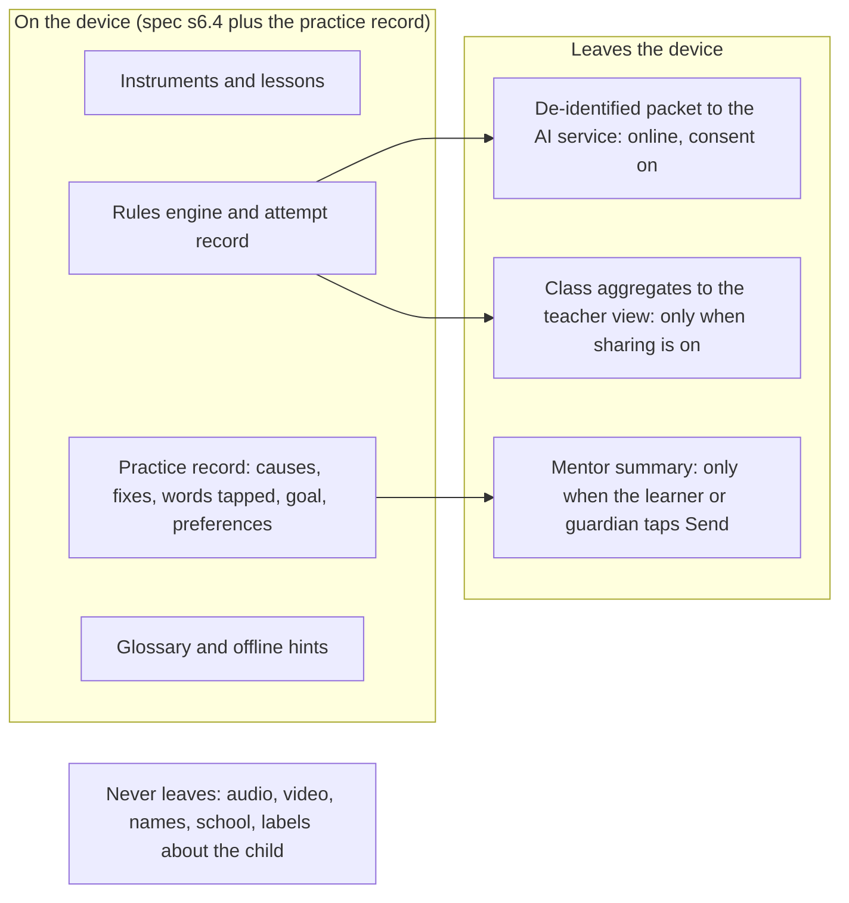
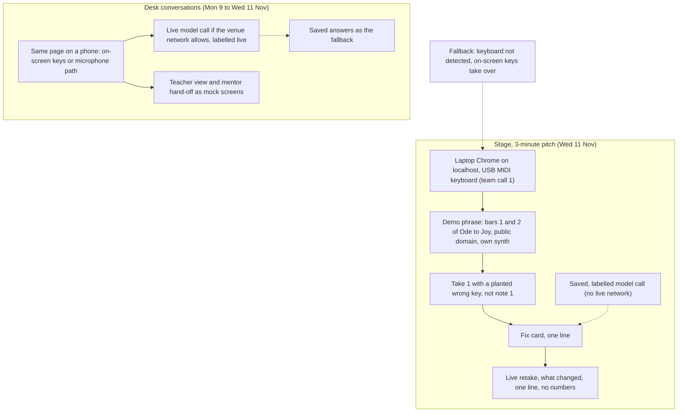

# Merged flowchart v0: the teammate spec as the frame, the overnight coach as the engine

Written 2026-11-08 20:20 by the session for Carlos, from the folder's own files only. Diagrams are Mermaid: GitHub renders them in the repo view; VS Code needs a Mermaid preview extension; or paste a block into a Mermaid live editor. Proposals until the team decides; the three open team calls are marked on the diagrams.

## 0. How to read this (conclusion first)

- Frame = the spec's modules and roles (ONB, INS, PLY, LSN, ASM, AIC, HNT, PRG, TCH, PRV, OFF).
- Engine = the overnight loop inside ASM, AIC, HNT and PRG: rules measure, one fix, no score, retake, stop rule, practice record.
- Five diagrams: product map (1), learner session loop (2), engine detail (3), data flow (4), stage versus desk (5).
- Marked on the diagrams: team call 1 input, team call 2 counts, team call 3 buyer (spec-review-v0 s2).

| Diagram | From the spec | From the overnight files |
|---|---|---|
| 1 Product map | Module names, roles, prototype scope | Which modules the engine lives in; the drop of the guitar |
| 2 Session loop | Onboarding without an account, lesson and task entry, hint ladder | Goal in own words, one fix card, retake card, stop rule, hand-off |
| 3 Engine | Attempt record FR-ASM-04, de-identified AI call | Rules decide, the model explains, validator, packet, record |
| 4 Data flow | Starter data flow s6.4 (device versus off device) | Practice record stays, summary leaves on send only |
| 5 Stage and desk | Prototype scope: front end only, offline fallback | Laptop plus USB MIDI keyboard, saved labelled call, 60 s demo |

## 1. Product map: where the engine sits inside the frame

- The spec keeps every module name and ID; the overnight work changes what four of them do inside.
- Three inputs feed one checker: on-screen keys, a MIDI keyboard, the microphone; the loop is the same.

## 2. Learner session loop: one practice session, not a chat

- No number, grade, star or pass or fail appears anywhere on this path (sunday-notes s3).
- The spec's hint ladder sits between the fix card and the retake; the model never decides.
- Small line under the card: nobody sees this unless you send it.

## 3. Engine detail: rules decide, the model explains

- Rules are fixed between releases; the learner state changes every take; the model is stateless (morning-notes s9).
- Under 15: typed text and measured numbers only, cloud off by default (morning-notes s8).

## 4. Data flow: on the device versus off the device

- One box for the spec's data-flow page: the record stays; the summary leaves only on send (sunday-notes s5).
- The record is openable by the child or guardian in plain words at any time (proposed FR-PRG-06).
- It ages, never ranks, and deletes or exports in one tap (FR-PRG-05, FR-TCH-05).

## 5. Stage versus desk: what runs where this week

- Stage input is team call 1; the on-screen keys are the fallback either way (freeze-and-rehearsal-playbook).
- Desk is where the phone-first story and the no-instrument access line are shown (morning-notes s7).

## 6. Team calls marked on the diagrams

| Call | Where it shows | Proposed call (spec-review-v0 s2) |
|---|---|---|
| 1 Input | Diagram 1 MIDI node, diagram 5 stage | MIDI keyboard on stage, on-screen keys as input and fallback |
| 2 Counts | Diagram 1 dotted edge to TCH, diagram 3 teacher view | Counts move from the learner's results to the teacher view |
| 3 Buyer | Not drawn: changes the pitch, not the flow | Sponsor outreach team, home-practice framing, teacher as user |
| 4 Coach look | Diagram 2 fix card | Tap answers on the fix card, typed text as the fallback |

## Method

- Written by the session from the named project files, opened 2026-11-08; no Codex, no local model, no web search.
- Diagram shapes follow the files; nothing new was decided here. Node text uses the spec's module IDs where one exists.
- Not rendered to an image on this PC; view on GitHub, in a Mermaid preview, or in a Mermaid live editor.

## Open questions

- Which input does the team put on stage (call 1), and does that change diagram 5 only or diagram 1 too?
- Does the team accept the counts move (call 2) so FR-PRG-01 changes in the spec?
- Who redraws the spec's data-flow image (s6.4) from diagram 4, and in which tool?
- Should diagram 2 become the user flow the spec's order of work asks for in step 3?

## Sources

- Music-App-Requirements-Specification/index.md s2 (roles, prototype scope), s3 module list, s6.4 starter data flow, s6.5 order of work, opened 2026-11-08.
- sunday-notes-2026-11-08.md s1 to s5 (direction, on-screen instrument, no-score rule, practice record, seven rows), opened 2026-11-08.
- morning-notes-2026-11-07.md s7 (screen top to bottom), s8 (rules decide, model explains), s9 (flow per prompt), opened 2026-11-08.
- spec-review-v0.md s2 (three collisions and the fourth), opened 2026-11-08.
- demo-instrument-decision.md and freeze-and-rehearsal-playbook.md for the stage nodes, as summarised in RESUME.md, opened 2026-11-08.
